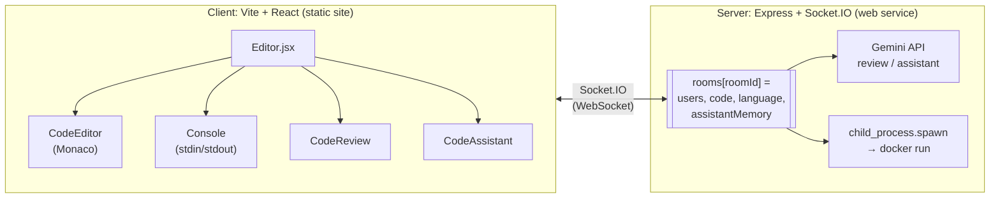

# CodeTogether

A real-time collaborative code editor. People join a room and edit the same
Monaco editor over Socket.IO. From the same room they can ask Gemini for a
code review or ask a coding assistant that remembers the conversation. There
is no database: a room only exists while someone is in it.

**Live:**
[Client](https://codetogether-client.onrender.com) ·
[Server](https://codetogether-rqqk.onrender.com)

> Both run on Render's free tier. The server sleeps after about 15 minutes
> idle and takes 30-50 seconds to wake up. The **Run** button (Java, Python,
> C++) only works locally, not on the hosted demo. [Code execution](#code-execution)
> explains why.

## Architecture



`rooms` is a plain in-memory object on the server, keyed by room ID. It is
created on the first `join-room` and deleted when the last user disconnects.

The only thing written to disk is the assistant's memory for each room
(`Server/uploads/assistant-memory/<roomId>.json`), so reloading the page in the
middle of a conversation keeps the context. That file is deleted when the room
empties, like everything else.

## Features

- **Real-time editing that merges.** The code is a [Yjs](https://yjs.dev)
  document, a CRDT. Each client sends only the edits it made, and every copy
  merges the same edits into the same text in any order, so two people typing
  on the same line at the same moment both keep their work. (The first version
  sent the whole file on every keystroke and the last one to arrive won.)
- **Live cursors and per-person undo.** Each member's cursor and selection show
  in their colour with their name. Ctrl+Z undoes only your own edits, not
  someone else's. The Monaco binding is
  [`Client/src/lib/monacoBinding.js`](Client/src/lib/monacoBinding.js).
- **Run, review and the assistant use the server's copy** of the document, so
  what runs is what everyone sees, not what one client claims the code is.
- **Unique usernames per room.** The server rejects a join if the name is
  already taken in that room, ignoring case. The check happens on the server,
  not in the client.
- **AI code review.** Sends the current code to Gemini (`gemini-2.5-flash-lite`,
  falling back to `gemini-3.1-flash-lite` on quota or rate-limit errors) and
  shows the review to the whole room.
- **Coding assistant with memory.** Each room keeps a short summary plus the
  last few turns. Once there are more than 8 turns or 1,200 characters, a
  second Gemini call folds the older turns into the summary, so long sessions
  don't grow the prompt without limit.
- **Sandboxed code execution** (local only). Each run gets its own named
  Docker container with `--network none`, `--memory=256m`, `--cpus=1`,
  `--pids-limit=64` and no privilege escalation. The command is an argument
  list, never a shell string. When a run passes 5 seconds or 64 KB of output,
  the server kills the container by name. (Earlier it killed only the
  `docker run` client, which left a looping program running.) See
  [`Server/src/execution/`](Server/src/execution/).
- **A job queue for runs.** At most `RUN_CONCURRENCY` containers (default 2) run
  at once on the server. Other runs wait in arrival order and the room sees
  its place in line. When 20 are waiting, new runs are refused instead of
  starting more containers than the machine can hold.
- **Limits on everything a client sends.** Room IDs and names are checked, code
  over 64 KB isn't run or sent to Gemini, single edits over 256 KB are dropped,
  and each person gets 10 runs and 6 AI requests a minute. See
  [`Server/src/limits.js`](Server/src/limits.js).
- **Runs without a Gemini key.** Editing, rooms and sync work without one. Review
  and assistant requests then get a "key missing" error instead of an answer.

## Code execution

`run-code` calls `docker run` directly, so it needs a Docker daemon on the
machine running the server. Render's free web services, like most free PaaS
tiers, can't run Docker inside the container. On the hosted demo the console
shows `docker: not found` and nothing is executed. Sync, rooms, review and the
assistant don't touch Docker, so they work there.

To use the Run button, run the server locally with Docker Desktop installed, or
deploy it to a VPS that has Docker.

## Getting started

**Prerequisites:** Node.js 18+, and Docker if you want the Run button.

```bash
git clone https://github.com/ankitsingathia/codetogether.git
cd codetogether
```

**Server**

```bash
cd Server
npm install
```

Create `Server/.env`:

```env
PORT=3001
BACKEND_URL=http://localhost
FRONTEND_ORIGIN=http://localhost:5173
GEMINI_API_KEY=your_gemini_api_key
```

You can get a key at [aistudio.google.com/apikey](https://aistudio.google.com/apikey).
It is only needed for review and the assistant.

```bash
npm run dev
```

**Client**

```bash
cd Client
npm install
```

Create `Client/.env`:

```env
VITE_SOCKET_URL=http://localhost:3001
```

```bash
npm run dev
```

Open `http://localhost:5173` in two browser windows, join the same room in
both, and type in one. The other should update straight away.

## Tests and CI

```bash
cd Server
npm test
```

[`Server/test/execution.test.js`](Server/test/execution.test.js) tests the run
pipeline without Docker, using a Node process in place of the container: a
program that never ends is stopped and its container killed by name, a program
that prints too much is cut off, the queue never runs more than its limit and
keeps arrival order, a waiting run can be cancelled, and the input checks and
rate limiter work.

[`Server/test/docker.test.js`](Server/test/docker.test.js) runs real containers
and is skipped unless `RUN_DOCKER_TESTS=1`. CI runs it in a separate job. It
checks that a looping program's container is really gone after the time limit,
and that the sandbox has no network.

[`Server/test/server.test.js`](Server/test/server.test.js) starts the real
server with no Gemini key and connects to it with Socket.IO clients, the way two
browser tabs would. It checks that:

- the server starts without a key
- a new room starts with the Java template
- usernames are unique within a room, ignoring case
- two clients typing at the same moment, in different places and at the same
  position, end up with identical text that contains both people's edits, and
  someone joining afterwards gets that same text
- an edit isn't sent back to the person who made it
- a socket that hasn't joined a room can't edit it, and a malformed update is
  dropped without crashing the server
- changing the language replaces the text for everyone
- a member's cursor disappears for the others when they leave
- a room resets once everyone has left
- a join with a malformed room ID or name is refused, and code over the size
  limit is refused before anything runs
- review and assistant requests without a key return an error and the server
  stays up

The first run of these tests found a real bug: the Gemini SDK throws when it is
created without a key, so the server crashed on startup even though the review
and assistant handlers were written to handle a missing key. It now creates the
client only when a key is set.

[CI](.github/workflows/ci.yml) runs the server tests, and the client's lint and
production build, on every push and pull request.

## Deploying your own instance

Both services deploy free on Render:

| Service | Type | Root | Build | Start |
|---|---|---|---|---|
| Server | Web Service | `Server` | `npm install` | `npm start` |
| Client | Static Site | `Client` | `npm install && npm run build` | publish `dist` |

Set `GEMINI_API_KEY` on the server and `VITE_SOCKET_URL` on the client (the
server's URL). Once the client has a URL, set `FRONTEND_ORIGIN` on the server to
it. The server rejects Socket.IO connections from any other origin (see
[`Server/src/cors.js`](Server/src/cors.js)).

## Tech stack

**Client:** React 19, Vite, Socket.IO client, Monaco Editor, Tailwind CSS,
react-markdown with remark-gfm for the review output, react-router-dom.

**Server:** Node.js, Express 5, Socket.IO, `@google/genai` (Gemini), uuid for
job and room IDs, dotenv. Tests use Node's built-in test runner.

## Project structure

```
Server/
├── index.js             Starts the server
├── src/
│   ├── server.js        Express + Socket.IO setup, wires the handlers
│   ├── config.js        Environment settings
│   ├── cors.js          Which origins may connect
│   ├── rooms.js         Room state and membership
│   ├── sockets/         Event handlers: room, execution, assistant
│   ├── execution/       Builds the `docker run` command for each language
│   └── ai/              Gemini calls and the assistant's per-room memory
├── test/                Socket-level tests against the running server
└── uploads/             Assistant memory per room, created at runtime (not in git)

Client/
└── src/
    ├── pages/            Home, CreateRoom, Editor
    ├── components/       CodeEditor, Console, CodeReview, CodeAssistant
    ├── layouts/          AppLayout, EditorLayout
    ├── lib/RoomSocket.js  Thin wrapper around the socket.io-client instance
    └── contexts/ThemeContext.jsx
```

## Known limitations

- **Last write wins, not a CRDT.** If two people type in the same spot at the
  same moment, the text can come out jumbled. That's fine for two people pair
  programming on a call, not for Google Docs-style editing by many people at
  once.
- **Room state is in memory.** Restarting the server drops every active room,
  and there's no way to reconnect and resume after a redeploy.
- **No auth.** Anyone with the room link and an unused username can join.
  Rooms are unlisted, not private.

## Contact

Ankit Singathia, [github.com/ankitsingathia](https://github.com/ankitsingathia)
